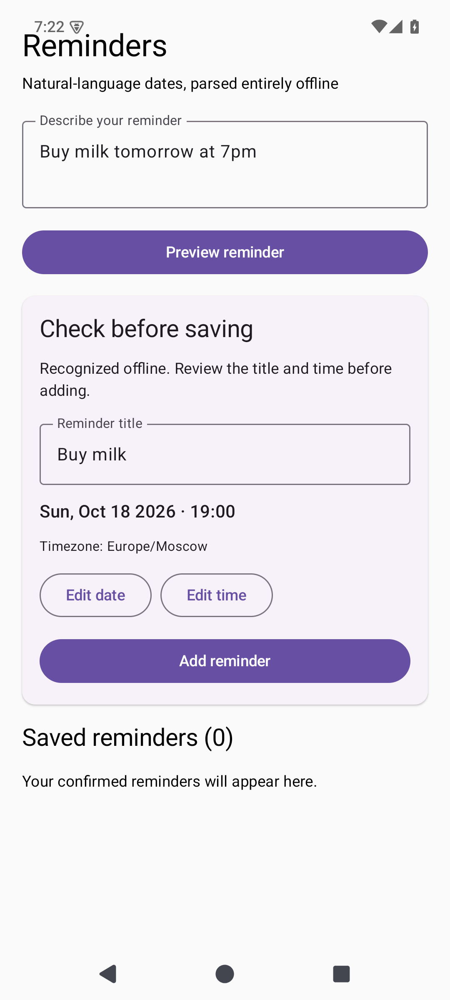
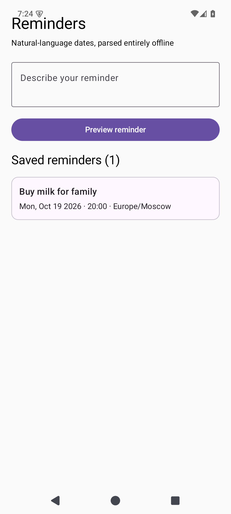
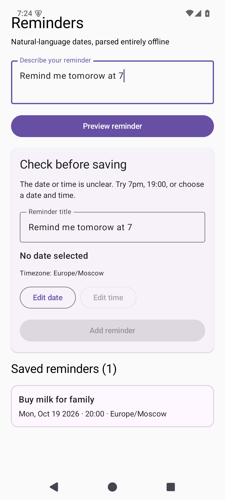

# DateParser Kotlin

[](https://central.sonatype.com/artifact/io.github.alox1d/dateparser-kotlin)
[](https://github.com/Alox1d/dateparser-kotlin/actions/workflows/ci.yml?query=branch%3Amain%20event%3Apush)
[](https://github.com/Alox1d/dateparser-kotlin/blob/main/LICENSE)
[](https://devshelf.ritualdev.in/tools/dateparser-kotlin.html)

[English](../en/index.md) | [Russian](../ru/index.md) | [Documentation](https://alox1d.github.io/dateparser-kotlin/)

Offline English and Russian natural-language date/time parser for Kotlin Multiplatform. Extract dates, times, ranges and recurrence periods from reminder text on Android, JVM and iOS, without an account, API key or network service.

**Version:** 0.1.2 | [Maven Central](https://central.sonatype.com/artifact/io.github.alox1d/dateparser-kotlin/0.1.2) | [Release notes](https://github.com/Alox1d/dateparser-kotlin/blob/main/CHANGELOG.md).

## Installation

Add `mavenCentral()` and the dependency to your shared module:

```kotlin
kotlin {
    sourceSets {
        commonMain.dependencies {
            implementation("io.github.alox1d:dateparser-kotlin:0.1.2")
        }
    }
}
```

The same coordinates work in a Kotlin/JVM or Android project. Gradle selects the platform artifact automatically.

## Runnable KMP demo

[Try the shared reminder demo](https://github.com/Alox1d/dateparser-kotlin/blob/main/integration/consumer/README.md) or follow the [English KMP walkthrough](https://alox1d.github.io/dateparser-kotlin/en/kmp-reminder-demo/). The example resolves **0.1.2 from Maven Central**, keeps the preview in `commonMain`, and checks JVM, Android and iOS consumers.

```sh
./gradlew -p integration/consumer runDemo -PcentralOnly=true --console=plain
```

It shows US/European date order, timezones and a reminder range with a fixed reference. You can also provide your own phrase. Building this checked-in example requires JDK 17-21 and Android SDK 35; see the demo README for native checks.

## Usage

```kotlin
import io.github.alox1d.dateparser.DateParser
import kotlin.time.Instant
import kotlinx.datetime.TimeZone

val parser = DateParser()
val reference = Instant.parse("2024-02-28T10:15:00Z")
val matches = parser.parse(
    text = "buy in 5 hours",
    reference = reference,
    timeZone = TimeZone.UTC
)
val instant = matches.single().instant // 2024-02-28T15:15:00Z
```

The Russian phrase `купить через 5 часов` produces the same instant. No Android `Context` or initialization is required. Passing reference time and timezone makes parsing reproducible. If omitted, the injected `Clock` (system clock by default) is read once and the system timezone is used. Results have second precision except elapsed offsets, which preserve reference subsecond precision.

## New in 0.1.2: first weekday of next month

`next Friday` has been supported since 0.1.1: it means the nearest Friday, skipping today when the reference is Friday.

Version 0.1.2 additionally recognizes `the first Monday of next month` and the corresponding form for any full weekday name (optional `the`; `first` or `1st`; case-insensitive).

The rule starts at day 1 of the next calendar month in the supplied timezone and selects the first requested weekday. For `2024-02-28T10:15:00Z` in UTC, `Pay rent on the first Monday of next month` resolves to `2024-03-04T10:15:00Z` with title `Pay rent`. An explicit `at 5PM` uses `17:00:00`; otherwise the reference clock is retained.

This is a one-off date, not an ordinal recurrence rule. The recognized unsupported forms (`second` through `fifth`, `last`, and numeric ordinals other than `1st`) and `every/each first ... of next month` are rejected rather than reduced to a partial weekday/month match. Other English ordinal wording is outside this addition. New grammar is added as explicit, documented rules with regression tests; arbitrary context-dependent prose is not inferred.

## English dates for the US and Europe

Named dates work in either order, with full or abbreviated months and optional ordinals. These examples use the reference time above and UTC:

| Input | Result |
| --- | --- |
| `December 31, 2026 at 5PM` / `31st Dec 2026 at 5 pm` | 2026-12-31 17:00:00 |
| `2026-12-31` | 2026-12-31 10:15:00 |
| `13/04/2026` / `04/13/2026` | 2026-04-13 10:15:00 |
| `today` / `yesterday` | 2024-02-28 / 2024-02-27, same reference clock |
| `Friday` / `on Friday` | 2024-03-01, same reference clock |
| `next week` / `next month` | 2024-03-06 / 2024-03-28 |
| `in 1 month and 2 days` | 2024-03-30 10:15:00 |
| `every 1 month and 2 days` | Calendar interval: 1 month and 2 days |
| `tomorrow from 5PM to 8PM` | 2024-02-29 17:00:00 to 20:00:00 |
| `Buy milk, at 17:30!` | 2024-02-28 17:30:00; remainder `Buy milk` |

For an ambiguous numeric date, choose the field order explicitly:

```kotlin
import io.github.alox1d.dateparser.DateOrder

val us = parser.parse("03/04/2026", DateOrder.MDY, reference, TimeZone.UTC)
// March 4, 2026
val eu = parser.parse("03/04/2026", DateOrder.DMY, reference, TimeZone.UTC)
// April 3, 2026
```

Without `DateOrder`, distinct ambiguous slash dates return no matches. Unambiguous slash dates and ISO dates are accepted automatically. `DateOrder.YMD` supports year/month/day slash dates. Dot dates retain the existing day/month/year convention, regardless of the selected slash order.

Russian examples include `завтра`, `через 5 часов`, `29.02.2024`, `завтра с 17:30 до 20:00`, `каждый месяц` and `каждые 2 дня`. English `in 5 hours` and Russian `через 5 часов` resolve to the same instant.

## Result and options

`DateMatch` is immutable:

- `targetDate`: resolved local `LocalDateTime`.
- `instant`, `timeZone`: resolved `kotlin.time.Instant` and the timezone used.
- `endDate`, `endInstant`: optional upper boundary; `null` when absent.
- `recurrence`: optional `kotlinx.datetime.DateTimePeriod`; months/years remain calendar units.
- `remainingText`: the rule engine's remaining reminder text, not a character-offset span.
- `confidence`: accumulated rule score, not a probability or a value limited to 100.

`ParseOptions(errorLimit = 1.0, minimumPrevalence = 50.0)` controls fuzzy matching and rule thresholds. `errorLimit` accepts 0..1; `minimumPrevalence` accepts 0..100. Blank text returns an empty list. Working state is independent per call.

## Platforms and build

Targets: Android API 26+, JVM (Java 8+), iOS arm64 device and Apple Silicon simulator. Kotlin 2.3.20, kotlinx-datetime 0.8.0, AGP 8.13.2 and Gradle 8.13 are pinned. Building requires JDK 17-21 and Android SDK 35. iOS compilation/tests additionally require full Xcode on macOS; CI uses an arm64 macOS runner.

Run the relevant checks from the repository root:

- JVM behavior tests: `./gradlew :dateparser:jvmTest`.
- Android host tests: `./gradlew :dateparser:testAndroidHostTest`.
- Android demo build: `./gradlew :app:assembleDebug`.
- iOS simulator tests: `./gradlew :dateparser:iosSimulatorArm64Test`.
- iOS device compilation: `./gradlew :dateparser:compileKotlinIosArm64`.
- Generated rules: `python3 scripts/generate_rules.py --check`.

The same common behavior suite runs on JVM, Android host tests and iOS simulator. This is not Android device instrumentation coverage. Using the library in shared Kotlin iOS code is supported; a standalone Swift/XCFramework distribution is not part of this release.

**Android API 24:** the published AAR declares `minSdk 26`, so Android 24 consumers cannot use it as-is. kotlinx-datetime uses `java.time` on Android; older API levels require [core library desugaring](https://developer.android.com/studio/write/java8-support) enabled by the consuming app. An isolated build with `minSdk 24` and `coreLibraryDesugaring` (`desugar_jdk_libs:2.1.5`) passed APK compilation, JVM/Android host tests, local KMP publication metadata checks, and a separate Gradle consumer. This verifies **build compatibility only**: no API 24 runtime image was available to test actual date parsing on a device. The supported minimum therefore remains 26.

## Local development and publication checks

Run these commands from the repository root:

- Root metadata: `./gradlew :dateparser:publishKotlinMultiplatformPublicationToTestRepository -PlocalPublication=true`.
- JVM artifact: `./gradlew :dateparser:publishJvmPublicationToTestRepository -PlocalPublication=true`.
- Android artifact: `./gradlew :dateparser:publishAndroidPublicationToTestRepository -PlocalPublication=true`.
- Consumer verification: `./gradlew -p integration/consumer jvmTest testAndroidHostTest`.

This writes an unsigned test Maven repository to `build/test-repository`. A separate KMP consumer resolves the real root metadata and platform artifacts. For a local iOS consumer, also run `:dateparser:publishAllPublicationsToTestRepository -PlocalPublication=true` on a Mac with Xcode. Do not use the local-publication flag for Central releases. See [publishing instructions](https://github.com/Alox1d/dateparser-kotlin/blob/main/docs/PUBLISHING.md).

## Migration from the Android-only port

Use `io.github.alox1d.dateparser.DateParser` from shared code. The deprecated Android-only `com.huawei.wordnote.domain.services.dateparser.ParsedDate` facade retains `prepareParse`, `parseDate` and `valueOf`; `prepareParse` is now optional and retains no Context. It retains `Calendar`, the old UTC-epoch month/year duration convention and a **zero sentinel for an absent end date**. Prefer the common API for nullable boundaries and calendar recurrence. This is entry-point compatibility, not binary compatibility with old AARs or compatibility with every historical internal helper/type. Android minimum SDK rises from 16 to 26.

## Limits

This is a rule-based parser with verified English and Russian forms; arbitrary prose can require additional rules. Missing date/time fields inherit the reference, except explicit English AM/PM clocks: `5PM` means `17:00:00`, and `5:30PM` means `17:30:00`. A bare clock is not automatically moved into the future. The inherited hour-24 rule normalizes `24:30` to next-day `00:30`. Weekdays mean the nearest occurrence, including today; `next Friday` skips a current Friday.

Relative hours/minutes/seconds are elapsed time; relative days/months/years use calendar arithmetic in the selected timezone, including month-end clamping. `next week/month/year` means a one-unit calendar offset from the reference. Recurrence must be positive and describes an interval, rather than a complete schedule.

A range end with no date inherits the start's calendar date. An earlier end clock rolls to the next day; inverted explicit dates return no match. Relative offsets used as range ends are currently rejected. Explicit DST gaps/overlaps follow kotlinx-datetime resolution rules, and both local boundaries reflect the resolved instants. A recognized invalid date/AMPM clock, an unresolved ambiguous slash date or a numeric overflow rejects the entire input, avoiding an unrelated partial match. `remainingText` preserves reminder words and case, but is not a byte-for-byte reconstruction or a source span.


## Android Compose reminder demo

The checked-in `app` module contains an interactive Compose reminder prototype. Run `./gradlew :app:installDebug` with an Android device or emulator, then open **DateParser**. Enter `Buy milk tomorrow at 7pm`, preview the extracted title and date, correct either field using the title editor/date/time pickers, and explicitly add the reminder to a session-only list. No notifications, account, or database are involved.

For ambiguous wording such as `Remind me tomorow at 7`, `Buy milk tomorrow 7, please`, or an invalid bare hour such as `tomorrow at 25`, the library rejects the unresolved time instead of quietly scheduling at the reference hour. Supply `7am`, `7pm`, or `19:00`, or select a date and time manually in the demo. A date-only expression such as `tomorrow` still inherits the reference time by design. The preview is always for review; a rule score is not a probability.

**Actual screenshots from an isolated Android API 35 emulator**, using the checked-in Compose demo:

| Parsed reminder | Edited and saved | Ambiguous time: manual review |
| --- | --- | --- |
|  |  |  |

The Android screen compiles the **same** `integration/consumer/src/commonMain/kotlin/ReminderDraft.kt` source as the standalone KMP consumer. UI edits and the in-memory list remain Android-only. A parsed range is not silently shortened to a single instant; the screen asks for a single time or manual selection. Manually chosen local times are validated for DST gaps and overlaps before saving.

### How a phrase becomes an instant

The caller fixes a reference instant and timezone. With `2026-10-15T10:15:00Z` and `TimeZone.UTC`, `tomorrow at 5 pm` means the following calendar date at 17:00 UTC: `2026-10-16T17:00:00Z`. In a different timezone the same local phrase may represent a different instant; daylight-saving gaps and overlaps use kotlinx-datetime's resolution policy. The parser does not guess the user's geographic timezone.

```kotlin
val reference = Instant.parse("2026-10-15T10:15:00Z")
val match = DateParser().parse("tomorrow at 5 pm", reference, TimeZone.UTC).single()
check(match.instant == Instant.parse("2026-10-16T17:00:00Z"))
val us = DateParser().parse("03/04/2026", DateOrder.MDY, reference, TimeZone.UTC)
val europe = DateParser().parse("03/04/2026", DateOrder.DMY, reference, TimeZone.UTC)
```

The slash date denotes March 4 with `MDY` and April 3 with `DMY`. Without a selected order, ambiguous slash dates return no match. Never store a reminder without reviewing a partial or ambiguous parse.

## License and origin

MIT. Port and adaptation of [Alexey Orazov's date-parser](https://github.com/alordash/date-parser), originally integrated into WordNote by Alexander Baranov. Original copyright and permission text are preserved in [LICENSE](https://github.com/Alox1d/dateparser-kotlin/blob/main/LICENSE); attribution and the verified upstream commit are in [THIRD_PARTY_NOTICES.md](https://github.com/Alox1d/dateparser-kotlin/blob/main/THIRD_PARTY_NOTICES.md). Historical Android sources/tests are retained under `legacy/android` for comparison and are not built or published.
