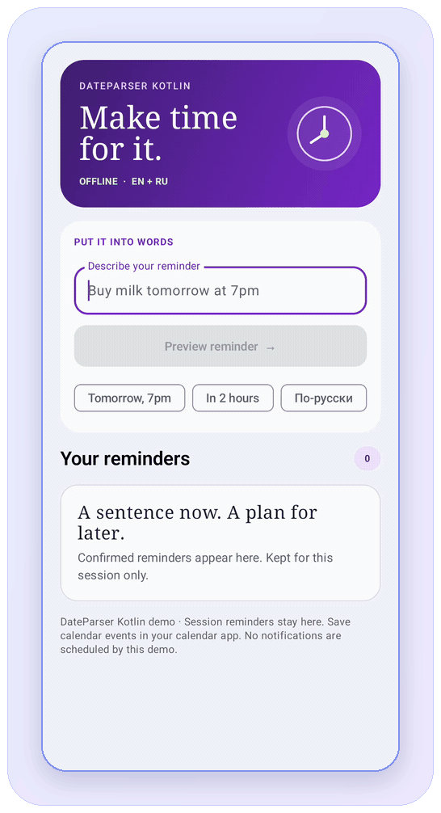
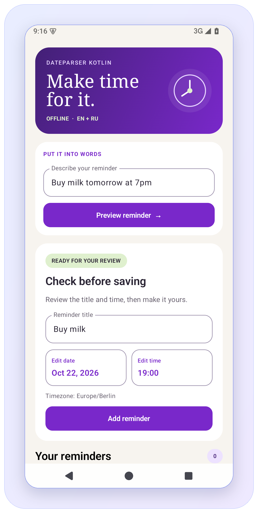
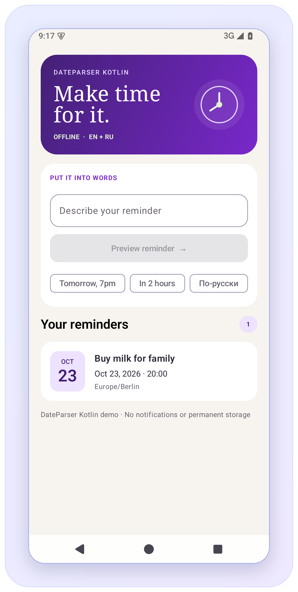
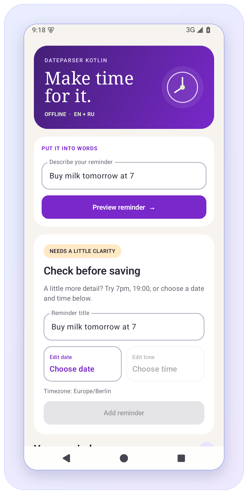

# DateParser Kotlin

*Локальное распознавание дат и времени из текста для Kotlin Multiplatform.*

Русский и английский · Android, JVM и iOS.

[](https://central.sonatype.com/artifact/io.github.alox1d/dateparser-kotlin)
[](https://github.com/Alox1d/dateparser-kotlin/actions/workflows/ci.yml?query=branch%3Amain%20event%3Apush)
[](https://github.com/Alox1d/dateparser-kotlin/blob/main/LICENSE)
[](https://devshelf.ritualdev.in/tools/dateparser-kotlin.html)

[English](../en/index.md) | [Русский](../ru/index.md) | [Документация](https://alox1d.github.io/dateparser-kotlin/ru/)

Извлекает даты, время, диапазоны и интервалы повторения из напоминаний. Работает без аккаунта, API-ключа и сетевого сервиса.

[Последний релиз](https://github.com/Alox1d/dateparser-kotlin/releases/latest) · [Изменения](https://github.com/Alox1d/dateparser-kotlin/blob/main/CHANGELOG.md) · [Каталог Kotlin Multiplatform](https://klibs.io/project/Alox1d/dateparser-kotlin)

**`Купить молоко завтра в 19:00` → `Купить молоко` + завтра, 19:00 в выбранном часовом поясе.**

## Как это выглядит

Введи фразу, проверь извлечённое название и время, затем добавь напоминание. Короткая запись работы Android Compose demo:



Демо хранит напоминания на время работы приложения и не отправляет уведомления.

## Подключение

Добавь `mavenCentral()` и зависимость в общий модуль:

```kotlin
kotlin {
    sourceSets {
        commonMain.dependencies {
            implementation("io.github.alox1d:dateparser-kotlin:0.1.3")
        }
    }
}
```

Те же координаты подходят для Kotlin/JVM и Android. Gradle автоматически выбирает артефакт нужной платформы.

## Использование

```kotlin
import io.github.alox1d.dateparser.DateParser
import kotlin.time.Instant
import kotlinx.datetime.TimeZone

val parser = DateParser()
val reference = Instant.parse("2024-02-28T10:15:00Z")
val matches = parser.parse(
    text = "купить через 5 часов",
    reference = reference,
    timeZone = TimeZone.UTC
)
val instant = matches.single().instant // 2024-02-28T15:15:00Z
```

`buy in 5 hours` даёт тот же результат. Android `Context` и предварительная инициализация не нужны. Явные время отсчёта и часовой пояс обеспечивают воспроизводимость. Если их не указать, внедрённый `Clock` (по умолчанию системный) читается один раз, используется системный часовой пояс. Точность результата - секунды; смещения в часах, минутах и секундах сохраняют долю секунды исходного времени.

## Запускаемый пример KMP

[Демо общего кода](https://github.com/Alox1d/dateparser-kotlin/blob/main/integration/consumer/README.md) и [практическая статья на английском](https://alox1d.github.io/dateparser-kotlin/en/kmp-reminder-demo/) используют опубликованную 0.1.3 из Maven Central. Код предпросмотра напоминания находится в `commonMain`; он проверяется на JVM, Android и iOS.

```sh
./gradlew -p integration/consumer runDemo -PcentralOnly=true --console=plain
```

Показаны MDY/DMY, часовые пояса и границы диапазона. Для этого проекта нужны JDK 17-21 и Android SDK 35; запуск и нативные проверки описаны в README демо.

Для **JVM-проекта без Android SDK** есть независимый [JVM consumer](https://github.com/Alox1d/dateparser-kotlin/blob/main/integration/jvm-consumer/README.md):

```sh
./gradlew -p integration/jvm-consumer run --console=plain
./gradlew -p integration/jvm-consumer run --args='--help' --console=plain
```

Достаточно JDK 17-21. Пример получает 0.1.3 из Maven Central и показывает английские и русские фразы, обе границы диапазона, часовые пояса и явный порядок даты. Отсутствие совпадения для собственной фразы возвращает ненулевой код приложения; неверные параметры сопровождаются понятным сообщением.

[iOS-приложение на SwiftUI](https://github.com/Alox1d/dateparser-kotlin/blob/main/integration/ios-app/README.md) использует тот же Kotlin-код предпросмотра: ввод, редактирование названия и обеих границ, явное подтверждение, список на время работы приложения. На Mac с Apple Silicon и полным Xcode открой `integration/ios-app/DateParserDemo.xcodeproj`. Это пример с исходным кодом, который собирает локальный framework из опубликованной Kotlin-зависимости; отдельного распространяемого Swift-пакета он не добавляет.

## Английские даты для США и Европы

Поддерживаются оба порядка названия месяца и дня, сокращения месяцев и порядковые числительные. Примеры используют указанное выше время отсчёта и UTC:

| Вход | Результат |
| --- | --- |
| `December 31, 2026 at 5PM` / `31st Dec 2026 at 5 pm` | 2026-12-31 17:00:00 |
| `2026-12-31` | 2026-12-31 10:15:00 |
| `13/04/2026` / `04/13/2026` | 2026-04-13 10:15:00 |
| `today` / `yesterday` | 2024-02-28 / 2024-02-27, часы из времени отсчёта |
| `Friday` / `on Friday` | 2024-03-01, часы из времени отсчёта |
| `next week` / `next month` | 2024-03-06 / 2024-03-28 |
| `in 1 month and 2 days` | 2024-03-30 10:15:00 |
| `every 1 month and 2 days` | Календарный интервал: 1 месяц и 2 дня |
| `tomorrow from 5PM to 8PM` | 2024-02-29 17:00:00 - 20:00:00 |

Для неоднозначной числовой даты явно выбери порядок полей:

```kotlin
import io.github.alox1d.dateparser.DateOrder

val us = parser.parse("03/04/2026", DateOrder.MDY, reference, TimeZone.UTC)
// 4 марта 2026
val eu = parser.parse("03/04/2026", DateOrder.DMY, reference, TimeZone.UTC)
// 3 апреля 2026
```

Без `DateOrder` неоднозначные даты со слешами дают пустой результат. Однозначные даты со слешами и ISO распознаются автоматически. `DateOrder.YMD` задаёт год/месяц/день. Формат с точками сохраняет порядок день/месяц/год независимо от выбранного порядка слешей.

Русские примеры: `завтра`, `через 5 часов`, `29.02.2024`, `завтра с 17:30 до 20:00`, `каждый месяц`, `каждые 2 дня`. `in 5 hours` и `через 5 часов` дают один момент времени.

### Дни недели и первый день недели следующего месяца

`next Friday` означает ближайшую пятницу, причём текущая пятница пропускается.

Парсер также распознаёт `the first Monday of next month` для любого полного английского названия дня недели. `the` необязательно, допускаются `first` и `1st`, регистр не важен.

Расчёт начинается с первого числа следующего календарного месяца в заданном часовом поясе. При reference `2024-02-28T10:15:00Z` и UTC фраза `Pay rent on the first Monday of next month` даёт `2024-03-04T10:15:00Z` и оставляет название `Pay rent`. Явное `at 5PM` задаёт `17:00:00`; без времени сохраняются часы reference.

Это разовая дата, не правило повторения. Распознанные неподдерживаемые формы (`second` - `fifth`, `last` и числовые порядковые формы, кроме `1st`) и `every/each first ... of next month` отклоняются, чтобы не выдавать частично распознанные день недели или месяц. Другие английские порядковые формулировки пока не поддерживаются. Грамматика расширяется отдельными документированными правилами и регрессионными тестами; произвольный контекст не угадывается.

## Результат и параметры

`DateMatch` неизменяемый:

- `targetDate`: вычисленные локальные дата и время, `LocalDateTime`.
- `instant`, `timeZone`: момент `kotlin.time.Instant` и использованный часовой пояс.
- `endDate`, `endInstant`: необязательная верхняя граница; `null`, если не задана.
- `recurrence`: необязательный `kotlinx.datetime.DateTimePeriod`; месяцы и годы остаются календарными единицами.
- `remainingText`: оставшийся текст напоминания по правилам алгоритма; это не диапазон позиций в исходной строке.
- `confidence`: сумма весов правил, не вероятность и не величина, ограниченная 100.

`ParseOptions(errorLimit = 1.0, minimumPrevalence = 50.0)` управляет нечётким сопоставлением и порогом правил. Допустимы `errorLimit` от 0 до 1 и `minimumPrevalence` от 0 до 100. Пустая строка или пробелы дают пустой список. Рабочее состояние каждого вызова независимо.

## Платформы и сборка

Целевые платформы: Android API 26+, JVM (Java 8+), iOS arm64 и симулятор на Apple Silicon. Зафиксированы Kotlin 2.3.20, kotlinx-datetime 0.8.0, AGP 8.13.2 и Gradle 8.13. Для сборки нужны JDK 17-21 и Android SDK 35. Для компиляции и тестов iOS дополнительно нужен полный Xcode на macOS; CI использует macOS arm64.

```sh
./gradlew :dateparser:jvmTest :dateparser:testAndroidHostTest :app:assembleDebug
./gradlew :dateparser:iosSimulatorArm64Test :dateparser:compileKotlinIosArm64
python3 scripts/generate_rules.py --check
```

Один общий набор поведенческих тестов выполняется на JVM, Android host и симуляторе iOS. Android host-тесты выполняются на JVM; передача события в календарь отдельно проверяется инструментальными тестами Android-примера. Подключение в общий Kotlin-код приложения iOS предусмотрено; отдельный выпуск Swift/XCFramework в эту версию не входит.

**Android API 24:** у опубликованного AAR задан `minSdk 26`. kotlinx-datetime использует `java.time`, а на более старых API приложению понадобится [core library desugaring](https://developer.android.com/studio/write/java8-support). В отдельной пробной сборке с `minSdk 24` и `coreLibraryDesugaring` (`desugar_jdk_libs:2.1.5`) успешно собраны APK, JVM/Android host tests, проверены локальные KMP-артефакты и независимый Gradle consumer. Но это подтверждает **только совместимость сборки**: на Mac не было эмулятора API 24 для проверки выполнения парсера. Поддерживаемый минимум пока 26.

## Локальная разработка и проверка публикации

```sh
./gradlew :dateparser:publishKotlinMultiplatformPublicationToTestRepository :dateparser:publishJvmPublicationToTestRepository :dateparser:publishAndroidPublicationToTestRepository -PlocalPublication=true
./gradlew -p integration/consumer jvmTest testAndroidHostTest
```

Команда создаёт неподписанный тестовый Maven-репозиторий в `build/test-repository`. Отдельный KMP-потребитель разрешает настоящие metadata и платформенные артефакты. Для локального iOS-потребителя дополнительно выполни `:dateparser:publishAllPublicationsToTestRepository -PlocalPublication=true` на Mac с Xcode. Флаг локальной публикации нельзя использовать для выпуска в Central. См. [инструкцию публикации](https://github.com/Alox1d/dateparser-kotlin/blob/main/docs/PUBLISHING.ru.md).

## Переход со старой Android-версии

В общем коде используй `io.github.alox1d.dateparser.DateParser`. Устаревший Android-фасад `com.huawei.wordnote.domain.services.dateparser.ParsedDate` сохраняет `prepareParse`, `parseDate` и `valueOf`; вызов `prepareParse` теперь необязателен и не сохраняет Context. Фасад сохраняет `Calendar`, старое преобразование месяцев/лет в длительность от UTC epoch и **ноль как признак отсутствия даты окончания**. Для необязательных границ и календарных повторов используй общий API. Это совместимость точек входа по исходному коду, а не бинарная совместимость со старым AAR или поддержка всех прежних внутренних типов. Минимальный Android SDK повышен с 16 до 26.

## Ограничения

Неоднозначные или некорректные часы (`tomorrow at 7`, `tomorrow 7, please`, `tomorrow at 25`) дают пустой результат. Укажи `7pm` или `19:00`, либо предложи выбрать время вручную. Одна дата `tomorrow` по-прежнему наследует часы времени отсчёта.

Парсер основан на правилах; произвольному тексту могут потребоваться дополнительные правила. Пропущенные поля берутся из времени отсчёта, кроме явного английского времени AM/PM: `5PM` означает `17:00:00`, а `5:30PM` - `17:30:00`. Время без даты автоматически не переносится в будущее. Правило часа 24 преобразует `24:30` в `00:30` следующего дня. День недели означает ближайшее наступление, включая сегодня; `next Friday` пропускает текущую пятницу.

Относительные часы, минуты и секунды означают прошедшее время; дни, месяцы и годы используют календарную арифметику часового пояса с ограничением последним днём месяца. `next week/month/year` означает сдвиг на одну календарную единицу. Интервал повторения должен быть положительным; он не заменяет планировщик.

Окончание диапазона без даты наследует календарную дату начала. Более ранние часы окончания переносятся на следующий день; явно заданная дата окончания раньше начала отклоняется. Относительные смещения в качестве окончания диапазона пока отклоняются. DST разрешается по правилам kotlinx-datetime; обе локальные границы соответствуют итоговым моментам времени. Распознанная некорректная дата или AM/PM-время, неоднозначная дата со слешами без выбора порядка и переполнение числа дают пустой результат всего вызова. `remainingText` сохраняет слова и регистр напоминания, но не воспроизводит исходник побайтово и не содержит позиций символов.


## Android Compose demo напоминаний

В модуле `app` есть рабочий Compose-пример: поле для фразы, предварительный результат, редактирование названия и даты/времени, подтверждение и список напоминаний на время работы приложения. Для запуска: `./gradlew :app:installDebug` и открыть **DateParser** на устройстве или эмуляторе. Можно сразу нажать на английский или русский пример. Изменение исходной фразы закрывает предыдущий предпросмотр: новый результат нужно проверить заново. Уведомлений, БД и авторизации нет.

Реальные скриншоты на Android API 35:

| Распознанное напоминание | Исправлено и сохранено | Неоднозначное время |
| --- | --- | --- |
|  |  |  |

Для `Buy milk tomorrow at 7pm` показываются название `Buy milk` и дата со временем. Фразы `Remind me tomorow at 7`, `Buy milk tomorrow 7, please` и некорректный час `tomorrow at 25` теперь отклоняются: одиночные числа без точного формата времени не должны приводить к тихому наследованию часов reference. Уточните `7am`, `7pm` или `19:00`, либо выберите дату и время вручную. Одна дата `tomorrow` по-прежнему наследует время reference. Не сохраняйте результат без подтверждения пользователем.

Android-экран использует **тот же** `integration/consumer/src/commonMain/kotlin/ReminderDraft.kt`, что и независимый KMP consumer. Обе границы диапазона сохраняются в предпросмотре и списке, каждую можно изменить. Ручное локальное время проверяется на пропуски и повторения при переходах DST отдельно для начала и конца. Неизменённый результат парсера сохраняет точный исходный момент.

**Open in calendar** передаёт проверенные название, начало, конец и часовой пояс в редактор Android-календаря через `ACTION_INSERT`. Для одиночной даты пользователь явно выбирает 30 минут или час, затем при необходимости редактирует показанный конец. Конец должен быть позже начала. Окончательное сохранение или отмена происходят в приложении календаря; демо не запрашивает разрешения календаря и не планирует уведомления. Если подходящего приложения нет, проверенные данные остаются на экране с пояснением.

UI-проверки: [изменение фразы закрывает старый предпросмотр](https://github.com/Alox1d/dateparser-kotlin/blob/main/.maestro/reminder-review.yaml) и [подтверждение, русские и английские примеры, неоднозначный ввод](https://github.com/Alox1d/dateparser-kotlin/blob/main/.maestro/reminder-safety.yaml). Запускаются через Maestro на тестовом устройстве после установки демо.

[Сценарий календаря](https://github.com/Alox1d/dateparser-kotlin/blob/main/.maestro/calendar-flow.yaml) проверяет явный выбор длительности, диапазон и состояние без обработчика на тестовом устройстве без приложения календаря. [Инструментальные Android-тесты](https://github.com/Alox1d/dateparser-kotlin/blob/main/app/src/androidTest/java/com/example/dateparser/CalendarIntentTest.kt) проверяют action, URI и extras настоящего Intent. Запуск: `./gradlew :app:connectedDebugAndroidTest` с `ANDROID_SERIAL`, указывающим тестовое устройство. Эти проверки не сохраняют событие в другом приложении.

### Как фраза превращается в момент времени

При reference `2026-10-15T10:15:00Z` и `TimeZone.UTC` выражение `tomorrow at 5 pm` означает `2026-10-16T17:00:00Z`. Парсер вычисляет завтрашнюю календарную дату в заданном часовом поясе и устанавливает 17:00 по местному времени. В другом поясе UTC-момент будет иным; переходы летнего времени разрешаются правилами kotlinx-datetime. По языку текста часовой пояс не угадывается.

```kotlin
val reference = Instant.parse("2026-10-15T10:15:00Z")
val match = DateParser().parse("tomorrow at 5 pm", reference, TimeZone.UTC).single()
check(match.instant == Instant.parse("2026-10-16T17:00:00Z"))
val us = DateParser().parse("03/04/2026", DateOrder.MDY, reference, TimeZone.UTC)
val eu = DateParser().parse("03/04/2026", DateOrder.DMY, reference, TimeZone.UTC)
```

При `MDY` это 4 марта, при `DMY` 3 апреля. Без `DateOrder` неоднозначная дата не распознаётся. `confidence` является оценкой правил, а не вероятностью правильности.

## Лицензия

MIT. Copyright и текст разрешения сохранены в [LICENSE](https://github.com/Alox1d/dateparser-kotlin/blob/main/LICENSE), сведения об исходном проекте - в [THIRD_PARTY_NOTICES.md](https://github.com/Alox1d/dateparser-kotlin/blob/main/THIRD_PARTY_NOTICES.md). Исторические Android-исходники и тесты в `legacy/android` сохранены для сравнения и не собираются и не публикуются.
